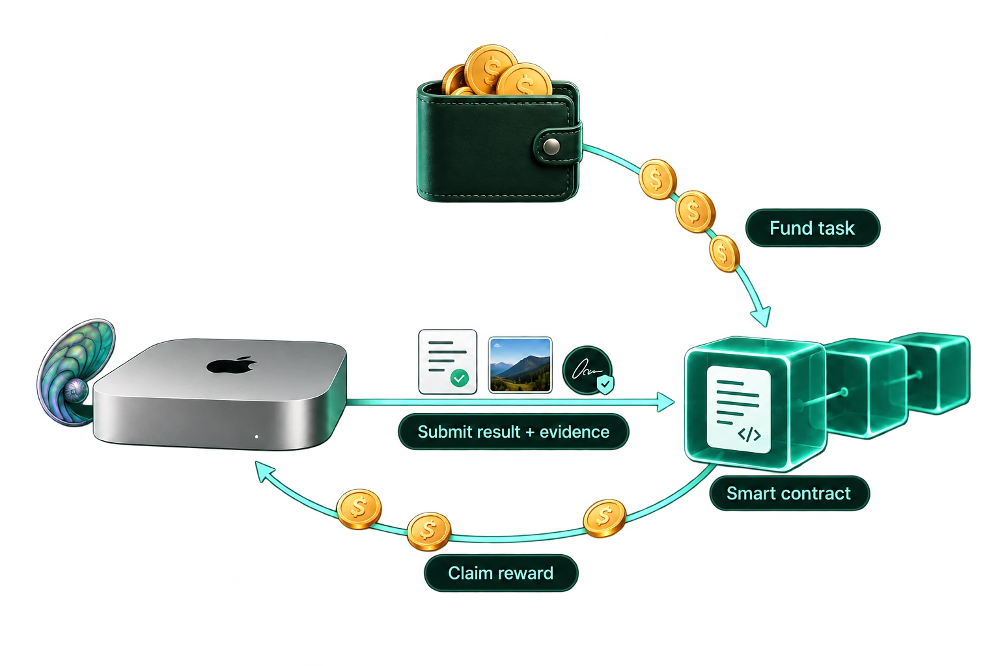

# Dsmack

Dsmack brings Apple App Attest verification to peer networks and smart contracts.
It recognizes independently signed copies of the same Mac program, so developers
can build and sign the software under their own Apple accounts. Peers can then
verify the app behind a signed message.

[Website](https://amiller.github.io/dsmack/) ·
[Architecture](docs/architecture.md) ·
[Run a task](docs/running.md) ·
[Claim a bounty](docs/participate.md) ·
[App Attest verifiers](app-attest/README.md)

<p align="center">
  <a href="https://amiller.github.io/dsmack/bounties.html"></a>
</p>
<p align="center"><em>The bounty application: fund a task, submit work with evidence, and claim the reward.</em></p>

## Applications

- **Peer-to-peer services:** authenticate the software on another Mac before
  exchanging requests or secrets.
- **Development bounties:** verify a contributor's execution evidence and test
  results before authorizing payment from a smart contract.

The repository includes verifiers written in Solidity, a zero-knowledge proof
implementation, and DsmackRunner—a signed macOS app that runs workloads inside a
Linux VM. The bounty application uses that runtime to check submitted code.
Arcade's Board-search task is its first example.

DsmackRunner reads the Linux image and task configuration at launch. The tools
and dependencies for each task go in its container, so different workloads can
reuse the same macOS app and Linux image.

<details>
<summary>VM execution path</summary>

```text
App Attest policy + approved code + signed messages       app-attest/, contracts/
  └─ VM execution runtime                                runner-vm/
       └─ Linux base + task container                    base-vm/
            └─ bounty checks and reward decisions        applications/bounties/
```

[Architecture](docs/architecture.md) explains the VM, disks and execution
records. [Running a task](docs/running.md) covers installation, execution,
verification and cleanup.

</details>

## Repository map

| Path | Role |
|---|---|
| [`app-attest/`](app-attest/README.md) | App Attest verification in Solidity and a Noir proof circuit |
| [`contracts/`](contracts/DEPLOY.md) | Approved-code and App Attest key registries; bounty escrow in `work-escrow/` |
| [`runner-vm/`](runner-vm/README.md) | Signed macOS app and its libkrun/Apple Hypervisor backend |
| [`base-vm/browser-sandbox-v1/`](base-vm/browser-sandbox-v1/README.md) | Linux guest, container runtime and input/output transport |
| [`applications/pilot-client/`](applications/pilot-client/README.md) | Shared Mac installation, launch, workload preparation and Linux verification tools |
| [`applications/bounties/`](applications/bounties/README.md) | Bounty service, worker tools and settlement; Arcade tasks under `examples/arcade/` |
| [`applications/bounty-dashboard/`](applications/bounty-dashboard/README.md) | Read-only view of contracts, tasks, attempts and payments |
| `verifier/` | Python App Attest verification |
| [`trust/`](trust/README.md) | Apple's App Attestation root certificate |
| `tools/release/` | Runner executable inspection |

## Build

The native archive needs Rust with the `aarch64-apple-darwin` target; the app
needs an Apple silicon Mac with Xcode:

```sh
runner-vm/native/build.sh
runner-vm/packaging/build.sh runner-vm/native/source-tree/target/aarch64-apple-darwin/release
```

The guest image, on a Linux builder:

```sh
python3 base-vm/browser-sandbox-v1/derive.py --base-bundle BASE --templates TEMPLATES --out OUT
```

Signing and release steps are in [docs/release/releasing.md](docs/release/releasing.md).

## Run

The [bounty worker tools](applications/bounties/runner/README.md) set up a
Mac, enroll it and run a task end to end. [docs/running.md](docs/running.md)
gives the underlying install, enroll, run, verify and cleanup commands.

## Test

Set up the tools as in [CONTRIBUTING.md](CONTRIBUTING.md), then:

```sh
./test.sh
```

This runs the Python verifier tests, both Foundry projects and the leaf circuit.
Each component README lists its own tests.
