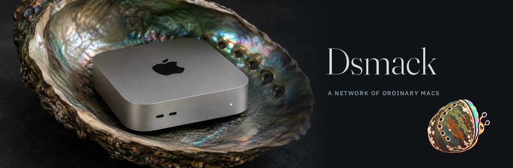
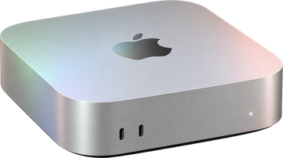
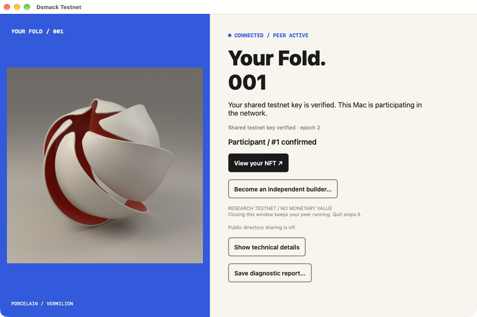
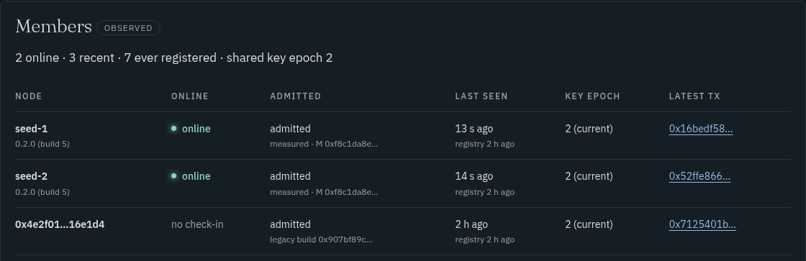

Your Mac joins a network that proves what code it runs. About five minutes, no terminal.

Dsmack is a peer-to-peer network of Macs, each running an app that proves with
Apple App Attest exactly which code it is. Its first service turns gift coupons
into private AI inference for [Abalone](https://github.com/amiller/abalone).
The website is [amiller.github.io/dsmack](https://amiller.github.io/dsmack/).

## Join the network

**[Download Dsmack Node 0.2.0](https://github.com/amiller/dsmack/releases/download/node-v0.2.0/DsmackNode-0.2.0.zip)**
· SHA-256 `955b1655a8b2f3d7a6997aae3cc799fce47a68b053cabb2f2517f35d3d3d611f`

You need an Apple silicon Mac on macOS 27 with Full Security and System
Integrity Protection on. You do not need
Xcode, an Apple Developer account, a wallet or gas. The app is signed with
Developer ID and notarized: accept the normal macOS prompt, and do not change
Gatekeeper settings to make it open.

1. Download the ZIP and extract it.

   

2. Open **Dsmack Node** and accept the prompt. It shows **Connecting.** while it
   enrolls with App Attest and finds a peer, then **You’re in.** once it holds
   the network's shared key.

   

3. Choose **Share in public node directory…** and find your node on the
   [dashboard](https://amiller.github.io/dsmack/nodes/).

   

If a step stalls, see [troubleshooting](docs/join.md#troubleshooting). If someone
sent you a gift coupon, you do not need to join; follow
[Redeem a coupon](https://github.com/amiller/abalone#redeem-a-coupon) in Abalone.

## Why join

The network runs on Base Sepolia, a testnet. Each Mac that joins is one more
attestation the network had to check and one more peer that can hand the key to
the next node, so joining helps show that admission works on Macs nobody here
controls. You can watch your node on the
[dashboard](https://amiller.github.io/dsmack/nodes/). Nothing is earned yet: the
participation receipt each node gets has no monetary value and does not prove a
unique person or Mac, and [mainnet has not launched](docs/mainnet.md).

## Build it yourself

You do not have to run our binary. Anyone with an Apple Developer account can
build Dsmack Node from source, sign it under their own team and join with it.
The network admits builds by their code measurement M, which leaves out who
signed them. [Build the Mac app under your own team](docs/build.md) has the
steps. On every change to the Mac code, CI builds the node under two made-up
teams and checks that both get the same M while a modified build does not;
[here is that run](https://github.com/amiller/dsmack/actions/runs/38295216891/job/114964549520)
for the 0.2.0 source.

## What the network is and is not

A joining node sends fresh App Attest evidence for its executable, and the
network hands over the shared key only if that build is admitted. It admits the
code, not the signer. What the people running it can still do:

- The registry's administrator decides which builds are admitted, and can change
  that decision on chain.
- The relay can delay or drop messages, and its sponsor can stop paying for the
  on-chain transactions.
- Every admitted node holds the full shared key, so one compromised node exposes it.
- The coupon service runs on one operator's Mac, and that operator can read the
  issuer's secrets. Joining does not make your Mac run it.

Dsmack does not hide your IP address. [Node details](docs/node-details.md) covers
updates, diagnostics, checking a release before you open it and the rest.

## Say hello

If you joined, say so in [I joined](https://github.com/amiller/dsmack/discussions/31).
If a step stalled, [open a join problem](https://github.com/amiller/dsmack/issues/new?template=join-problem.yml).
Other questions go in [Discussions](https://github.com/amiller/dsmack/discussions).

## More

- [Architecture](docs/architecture.md), [protocols](docs/protocols/README.md)
  and the [full documentation index](docs/README.md)
- [Mac builds](docs/native-build.md) pins the toolchain and checks that two
  builds match; [independent builders](docs/native-builder.md) covers signing
  under your own team
- [Contributing](CONTRIBUTING.md), [issues](https://github.com/amiller/dsmack/issues)
  and [security reporting](SECURITY.md)

Source is under the [MIT license](LICENSE); vendored dependencies keep their own notices.
