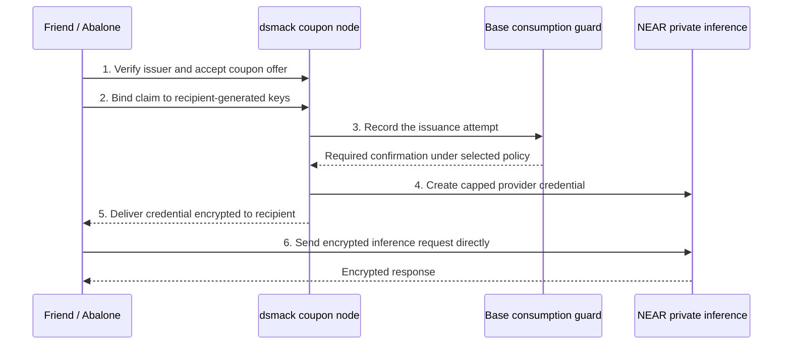

# dsmack

dsmack is a peer-to-peer service network for private inference. It is being built
to redeem coupons for provider access and route requests through contributed API
authorization. [Abalone](https://github.com/amiller/abalone) is the companion
guide and client for starting an incognito inference session.

**Public testnet release in preparation.** The bounded NEAR coupon trial has
delivered a capped provider credential and supported useful inference. Public
installation, the persistent testnet profile and independent friend acceptance
are still being qualified. This source candidate is not a production release.

## Try a gift

The release will provide one Abalone installation and redemption path for Linux.
Recipients need a coupon, not the sponsor's provider credentials or a funded
wallet. Incognito does not require a VPN. Until the
[friend-release gate](https://github.com/amiller/abalone/issues/4) passes, there
is no qualified public installation command to copy from this README.

This describes the existing direct NEAR route. The coupon node handles issuance;
it does not proxy that session's prompts. The cap is a spending limit on a
sponsor-managed credential, not a separate cash balance. The sponsor retains
revocation powers. Recipient-controlled wallet funding and inference routing
are separate paths under investigation.

## Network and privacy status

Development and staging are private environments. The planned public testnet is
a stable, observable preview with controlled upgrades. Production is not yet
qualified. A public testnet may use a Base mainnet contract with bounded real
funds: network release stage and blockchain network are separate settings.

The current coupon evidence establishes one staging issuer and connected clients,
not a count of independent node operators. The
[network status work](https://github.com/amiller/dsmack/issues/28) must publish
observation times and distinguish healthy, stale, unknown and not deployed.
Historical relay activity is not a peer census.

Attestation and privacy claims belong to the exact selected runtime profile.
The current debug trial does not qualify private issuer custody or rollback
protection. Its accepted provider security-update exceptions must remain visible
at admission. Incognito does not promise IP anonymity, and session-only
credentials are lost when the session closes. See the [charter](docs/charter.md)
for the project's requirements on privileged control.

## Build and contribute

Start with [Contributing](CONTRIBUTING.md), [source orientation](docs/start-here.md)
and the [roadmap](docs/roadmap.md). The
[synthetic coupon package](packaging/coupon/README.md) provides a bounded local
development exercise; it is not the public testnet deployment recipe.
Native Mac participation has its own [builder guide](release/builder-guide.md)
and [historical acceptance record](release/assembly-acceptance.md).

Track the [friend-release feedback batch](https://github.com/amiller/dsmack/issues/47)
and [release preparation](docs/public-testnet-release.md). Public source selection,
first-party licensing, fixture review and portable build qualification remain
open. Historical deployment guides retain their original scope and dates.
